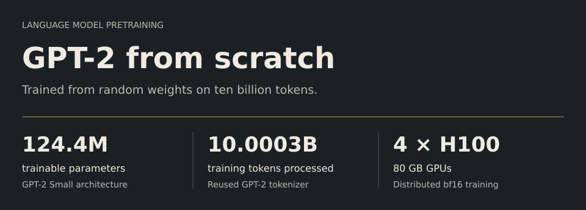
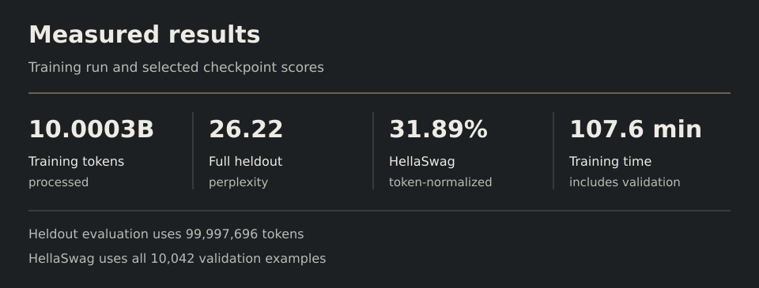
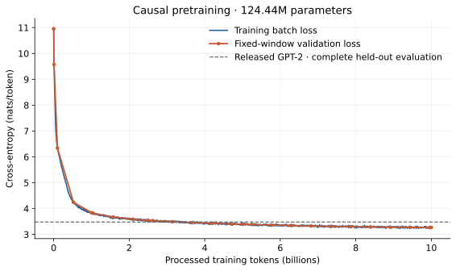
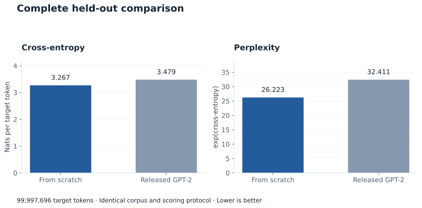
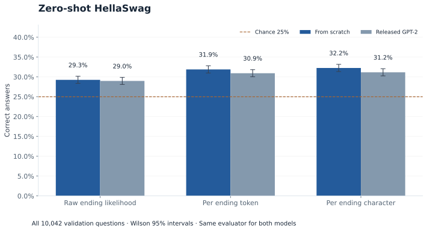
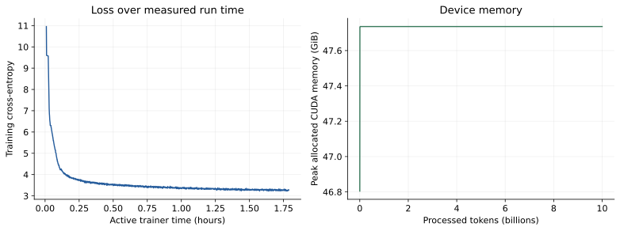
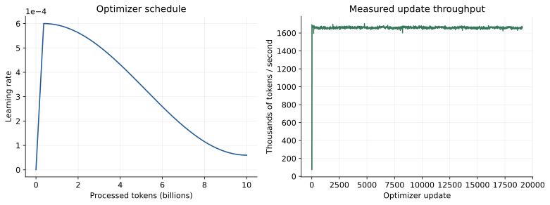
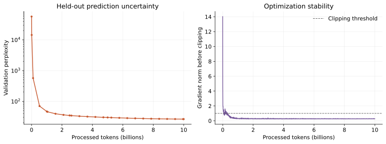
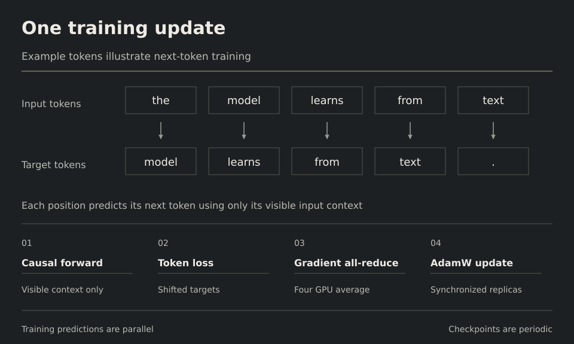
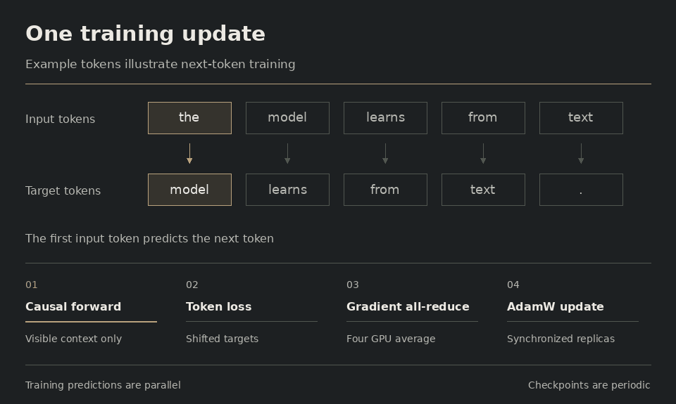

This project builds GPT-2 Small in PyTorch and trains its 124.4 million
parameters from random initialization on FineWeb. The run processed ten billion
tokens using four H100 GPUs. The repository covers the whole process, from
preparing the text and training across GPUs to evaluating the model and
generating continuations.

[Results](#measured-results) · [Architecture](#model-design) · [Reproduce](#reproduce-the-experiment) · [Code walkthrough](docs/walkthrough.md) · [Full report](reports/final)

## Measured results



Training ran for **19,074 optimizer updates**, reaching
**10,000,269,312 processed tokens**. Each update uses a full batch of 524,288
tokens, so the last batch took the total slightly past the 10B target.

Training took **107.6 minutes**, including startup, periodic validation, and
checkpoint saves. Data preparation and final evaluation were timed separately.

During training, the model was evaluated on the same held-out sample at regular
intervals. The checkpoint at **step 19,000**, after **9,961,472,000 tokens**,
had the lowest loss on that sample. It supplies the evaluations and generated
text below. Training continued through step 19,074.

| Measurement | From scratch | Released GPT-2 |
| --- | --- | --- |
| Held-out cross-entropy | 3.2666 | 3.4785 |
| Held-out perplexity | 26.223 | 32.411 |
| HellaSwag raw accuracy | 29.26% | 28.98% |
| HellaSwag token-normalized accuracy | 31.89% | 30.92% |
| HellaSwag character-normalized accuracy | 32.24% | 31.16% |

Each model was scored on **99,997,696 held-out next-token targets** and
**all 10,042 HellaSwag validation questions**. The JSON reports give the full
held-out scores and settings for the [trained model](reports/final/evaluation.json)
and [released GPT-2](reports/final/reference_evaluation.json). HellaSwag results
are available for the [trained model](reports/final/hellaswag.json) and
[reference](reports/final/hellaswag_reference.json).



The curve shows loss as training progresses. Its validation points come from
the fixed sample used to choose the checkpoint. The final evaluation then
scored the held-out corpus in non-overlapping windows.

Both models use the same tokenizer, evaluation text, and scoring code. Released
GPT-2 was originally trained on a different corpus. The lower perplexity here
shows how well this model predicts held-out FineWeb text. The HellaSwag gap is
small, and the confidence intervals overlap. More training seeds and a
question-by-question comparison would help determine how reliable that gap is.
[The evaluation guide](docs/evaluation.md) explains the scoring choices and
their effect on the reported numbers.

<details>
<summary>Full evaluation comparisons and uncertainty</summary>





The HellaSwag chart includes 95% Wilson intervals based on the number of correct
answers. Repeating training with different seeds would also help measure how
much the model's score varies from run to run.

</details>

<details>
<summary>Training speed, memory and optimization</summary>







The trainer logs an update every ten steps. The median logged update processed
**1.660M tokens per second**. Across the full training time, including startup,
validation, and checkpoint saves, the average was **1.549M tokens per second**.

Peak CUDA allocation reached **47.74 GiB** on rank zero. This measures the
largest amount of memory held by PyTorch tensors on that GPU during the trainer
process. [The runtime guide](docs/benchmark.md) explains each timing and memory
measurement.

</details>

## Model design


Each token becomes a 768-dimensional vector, which passes through twelve
transformer blocks. Within each block, twelve attention heads combine information
from the token's visible context. Each head has 64 features. A feedforward
network then expands the vector to 3,072 features, applies GELU, and projects
it back to 768. LayerNorm comes before each attention and feedforward operation.

Learned position vectors support contexts of up to 1,024 tokens. The input
embedding and output vocabulary projection share a single 50,257 × 768 matrix.

The model weights start at random, and the existing GPT-2 BPE tokenizer converts
text into token IDs. A manual attention implementation shows the masking and
matrix operations step by step. Training uses PyTorch's scaled dot-product
attention, with tests comparing the two implementations. The output projections
in each residual branch start with smaller weights to control variance as
activations pass through the twelve blocks.

[The architecture guide](docs/architecture.md) follows these tensor
transformations and derives the model's parameter count.

## Training recipe



<details>
<summary>Follow one training update in motion</summary>



The example sentence shows how each input token predicts the next token. The
animation highlights the context available to each prediction, then follows
the loss, gradient averaging, and AdamW update.

</details>

| Choice | Configuration |
| --- | --- |
| Corpus | FineWeb sample-10BT at a pinned dataset revision |
| Split | Whole-document hash assignment with a 1% validation fraction |
| Effective batch | 524,288 tokens through 64 sequences × 1,024 tokens × two accumulation steps × four GPUs |
| Optimizer | AdamW with betas 0.9 and 0.95, matrix weight decay 0.1 and gradient clipping 1.0 |
| Schedule | 700-update warmup to 6e-4 followed by cosine decay to 6e-5 |
| Execution | bfloat16, fused CUDA AdamW, SDPA, compilation and DistributedDataParallel |
| Resume | Checkpoints contain model, optimizer, and each GPU's random and sampler state |
| Model selection | Lowest fixed-sample validation loss |

The prepared corpus contains **14,357,844 documents**, **9.900B training
tokens**, and **99.998M held-out tokens**. After the model has seen every training
window, the sampler reshuffles them and starts another pass. Revisited windows
count toward the 10B processed-token total.

[The training guide](docs/training.md) explains the document split, batching,
optimizer, and how an interrupted run resumes.

## Reproduce the experiment

Run these commands from the repository root. The editable install makes the
`gpt2` package available to Python while you work on its source files.

```bash
python -m pip install -e '.[data,eval,dev]'
python -m unittest discover -s tests

python -m gpt2.prepare_data \
  --hf-dataset HuggingFaceFW/fineweb \
  --hf-config sample-10BT \
  --hf-revision 9bb295ddab0e05d785b879661af7260fed5140fc \
  --out data/fineweb10b \
  --max-tokens 10000000000

torchrun --standalone --nproc_per_node=4 --module gpt2.train \
  --config configs/h100-4gpu.json
```

This configuration targets four H100 80 GB GPUs. Give a new run its own output
directory. To continue an interrupted run, add
`--resume runs/gpt2-fineweb10b-h100-4gpu/last.pt` to the training command.

```bash
python -m gpt2.evaluate \
  --checkpoint runs/gpt2-fineweb10b-h100-4gpu/best.pt \
  --data data/fineweb10b \
  --out runs/gpt2-fineweb10b-h100-4gpu/evaluation.json \
  --verify-data

python -m gpt2.generate \
  --checkpoint runs/gpt2-fineweb10b-h100-4gpu/best.pt \
  --prompt "The history of science"
```

[The GPU setup guide](docs/runpod.md) walks through environment setup, batch-size
selection, and evaluating the trained checkpoint. [The testing guide](docs/validation.md)
explains how the model, data loader, checkpoint resume, and evaluators are tested.

[Five fixed-prompt continuations](docs/samples.md) show what the model
learned to generate. The text often reads fluently within a passage, but it
also repeats itself, drifts between topics, and invents scientific claims.
[The generation file](reports/final/samples.jsonl) includes the prompts, seeds,
and sampling settings.

## Code map

The `gpt2` package contains the model and the tools used throughout the run.

| Module | Role |
| --- | --- |
| [model](gpt2/model.py) | Defines the transformer and generates tokens from a prompt |
| [tokenizer](gpt2/tokenizer.py) and [prepare_data](gpt2/prepare_data.py) | Convert FineWeb documents into token IDs and assign them to the training or validation split |
| [data](gpt2/data.py) | Read packed token windows from disk and give each GPU distinct batches |
| [train](gpt2/train.py) | Run distributed training, update the learning rate, evaluate checkpoints, and resume interrupted runs |
| [checkpoint](gpt2/checkpoint.py) | Save model and optimizer state so training can resume from the same point |
| [provenance](gpt2/provenance.py) | Record the dataset, configuration, and software versions used for a run |
| [benchmark](gpt2/benchmark.py) and [verify_gpu_resume](gpt2/verify_gpu_resume.py) | Compare batch configurations and test checkpoint continuation on CUDA |
| [evaluate](gpt2/evaluate.py) and [evaluate_hellaswag](gpt2/evaluate_hellaswag.py) | Score held-out text and HellaSwag, using the same settings for this model and released GPT-2 |
| [generate](gpt2/generate.py) and [sample](gpt2/sample.py) | Generate a continuation from a prompt or run the fixed prompt suite |
| [plot_metrics](gpt2/plot_metrics.py) | Draw loss, optimization, memory, and runtime figures from the training logs |

[The code walkthrough](docs/walkthrough.md) follows one prediction from the
data loader through the transformer, optimizer update, and evaluation.

<details>
<summary>Execution and reporting scripts</summary>

| Script | Role |
| --- | --- |
| [setup_runpod.sh](scripts/setup_runpod.sh) | Install the environment and record dependency versions |
| [prepare_fineweb.sh](scripts/prepare_fineweb.sh) | Prepare the FineWeb token files or resume preparation |
| [run_stage.sh](scripts/run_stage.sh) | Run a named preflight, training, resume, evaluation, sampling or plotting stage |
| [complete_run.sh](scripts/complete_run.sh) | Evaluate an existing checkpoint, generate the prompt suite, and draw training figures |
| [run_experiment.sh](scripts/run_experiment.sh) | Run setup, continuation tests, batch-size selection, data preparation, and training in sequence |
| [analyze_results.py](scripts/analyze_results.py) | Check the logged measurements and draw milestone and uncertainty figures |
| [render_visuals.py](scripts/render_visuals.py) | Draw the documentation SVGs and training animation from the report data |

</details>

[The visual generation guide](docs/visuals.md) explains how to redraw the
diagrams and animation, including the commands, dependencies, and font options.

## Results and tests

[The final report](reports/final) contains the training logs, evaluation scores,
generated text, configuration, and figures. Reports from
[preflight](reports/preflight-h100-4gpu), [1B tokens](reports/progress-1b), and
[5B tokens](reports/progress-5b) show the earlier stages of the run.

The tests check causal attention, gradient accumulation, data sampling,
checkpoint recovery, and evaluation scoring.
[The testing guide](docs/validation.md) explains these checks and how to run
them. The final report also includes a
[numerical summary](reports/final/analysis.json) and
[training milestones](reports/final/milestones.csv).

## What to explore next

This experiment uses one training seed and one optimization recipe. Repeating
it with more seeds would show how much the results vary. Changing one part of
the recipe at a time would help measure its contribution to model quality and
training speed. The corpus uses FineWeb's existing filtering. Additional
near-duplicate filtering and benchmark decontamination remain future work.

Generation uses temperature and top-k sampling to continue a prompt. A later
instruction-tuning stage could train the model to respond to requests. The
current generation code recomputes the context for each new token. Adding a KV
cache would make this faster by reusing earlier attention keys and values.
Further benchmarks would help describe the model's strengths and weaknesses
beyond text prediction and HellaSwag.

## References

[OpenAI GPT-2](https://github.com/openai/gpt-2) ·
[FineWeb](https://huggingface.co/datasets/HuggingFaceFW/fineweb) ·
[build-nanogpt](https://github.com/karpathy/build-nanogpt) ·
[llm.c 124M experiment](https://github.com/karpathy/llm.c/discussions/481) ·
[EleutherAI HellaSwag protocol](https://github.com/EleutherAI/lm-evaluation-harness/blob/main/lm_eval/tasks/hellaswag/utils.py)
