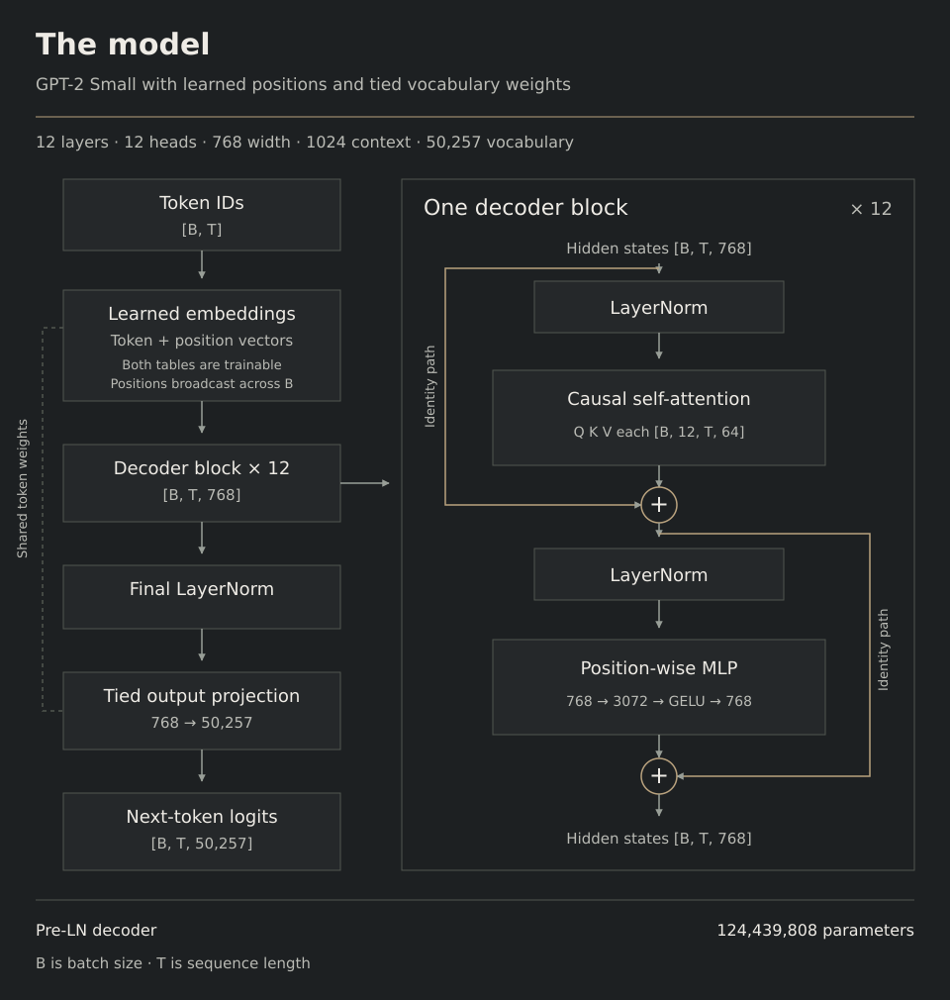

# Model architecture

The model learns to predict the token that follows each position in a piece
of text. It uses the GPT-2 Small architecture, with twelve decoder blocks,
twelve attention heads, and 768 features at each position. Training starts
with randomly initialized model weights. Text is converted to IDs using the
existing GPT-2 byte-pair tokenizer and its 50,257-token vocabulary.



## From token IDs to vectors

The forward pass begins in `GPT.forward` with an integer tensor of shape
`[B, T]`. Here, `B` is the number of sequences in the batch and `T` is the
number of tokens in each sequence. Every ID selects a row from the token
embedding matrix, turning it into a vector of 768 learned features.

The model also looks up a position vector for each offset in the sequence.
Adding the token and position vectors gives a tensor of shape `[B, T, 768]`.
These vectors carry information about both the text and its order. The
position table has 1,024 rows, which sets the maximum context length.

This tensor passes through all twelve decoder blocks. Each block updates it
twice, first by combining information across visible positions through
attention, then by transforming the features at each position through a
feedforward network. Its shape stays `[B, T, 768]` throughout the stack.

## How attention uses the context

`CausalSelfAttention.forward` begins with one linear projection that produces
queries, keys, and values. Its output is split into three tensors, each of
shape `[B, T, 768]`. The code then divides the feature axis into twelve heads
of width 64, giving each tensor shape `[B, 12, T, 64]`.

For each position, a query is compared with the keys at visible positions.
Those scores are scaled by the square root of the head width and converted
to attention weights. Scaling controls how the score magnitude grows with
the head width. The weights determine how much of each value vector
contributes to the output. One head computes

```math
\mathrm{softmax}\left(\frac{QK^\top}{\sqrt{64}}+M\right)V.
```

The mask `M` is zero for the current position and earlier positions. It adds
negative infinity to scores for later positions, giving those positions zero
weight after softmax. The diagonal stays visible because the current input
token helps predict the following token.

The twelve head outputs are concatenated into `[B, T, 768]` and passed
through another learned projection. This lets the block combine information
from different heads before adding it to the incoming vectors.

The implementation offers two ways to compute attention. The manual path
builds the score matrix and mask directly, making the equation easy to follow
in code. The SDPA path calls PyTorch scaled dot-product attention with
`is_causal=True`, allowing PyTorch to choose a suitable CUDA kernel. The
[model tests](../tests/test_model.py) compare their outputs and gradients.

## The two updates inside a block

Each sublayer receives a LayerNorm-normalized copy of its input. LayerNorm
centers and scales the features within each token vector, then applies learned
scale and bias parameters. Placing it before attention and the feedforward
network gives the block its pre-normalized structure.

The feedforward network expands each token's 768 features to 3,072, applies
the tanh approximation to GELU, and projects back to 768. Its weights are
shared across positions, and each position is transformed independently.
Attention supplies information from the context; this network builds new
combinations of features within the resulting token representation.

Both sublayers add their output to the vectors they received. These residual
paths carry the current representation forward alongside each learned
update, and provide a direct route for gradients during backpropagation.
For an incoming tensor `x`, the block computes

```math
h = x + \mathrm{Attention}(\mathrm{LayerNorm}(x))
```

```math
y = h + \mathrm{MLP}(\mathrm{LayerNorm}(h)).
```

## Turning the final vectors into predictions

After the twelfth block, a final LayerNorm prepares the vectors for the
vocabulary projection. During training this produces logits with shape
`[B, T, 50,257]`, giving one score for every possible next token at every
position. The vocabulary projection shares its matrix with the input token
embedding, so both operations learn from the same set of weights.

The data loader reads a window of `T + 1` source tokens. Its first `T` tokens
become the inputs, and its last `T` tokens become the targets. A prediction at
position `i` is therefore compared with source token `i + 1`. Cross-entropy
averages the negative log probability of these targets over all `B × T`
positions. Its vocabulary softmax converts scores into token probabilities;
the earlier attention softmax distributes weights across context positions.

Documents are packed into the stream with an end-of-text token between them.
A context window can span several documents. Attention and loss are computed
across the whole window, with the separators giving the model information
about document endings. The held-out evaluator follows the same convention.

## Where the parameters go

| Component | Shape or count | Unique parameters |
| --- | --- | --- |
| Token embedding | 50,257 × 768 | 38,597,376 |
| Learned position embedding | 1,024 × 768 | 786,432 |
| Twelve transformer blocks | 7,087,872 per block | 85,054,464 |
| Final LayerNorm | Scale and bias of width 768 | 1,536 |
| Vocabulary projection | Shares the token embedding matrix | 0 additional |
| Total | 12 layers · 12 heads · width 768 | **124,439,808** |

For model width `C`, attention contributes $4C^2 + 4C$ parameters and the
feedforward network contributes $8C^2 + 5C$. The two LayerNorms add $4C$.
A block therefore has $12C^2 + 13C$ parameters, which gives 7,087,872 at
`C = 768`. Sharing the vocabulary matrix saves a second matrix of 38,597,376
parameters.

## Initialization and generation

Linear and embedding weights start from a zero-mean normal distribution
with standard deviation 0.02, and linear biases start at zero. LayerNorm
starts with unit scale and zero bias, using epsilon 1e-5. The attention and
feedforward output projections use standard deviation $0.02 / \sqrt{2L}$,
where `L = 12`. This smaller initialization controls how much the twelve
blocks add to the residual stream at the start of training. Dropout is
disabled in this recipe.

`GPT.generate` repeatedly predicts and samples the next token, appends it,
and runs another forward pass. It uses the most recent 1,024 tokens once the
sequence grows beyond the position table. Each pass projects only its final
position into the vocabulary, since that is the prediction needed next.
The current generation loop recomputes the context on every pass. A KV cache
would allow it to reuse earlier attention keys and values and reduce the
work needed for longer continuations.

Read [model.py](../gpt2/model.py) alongside this guide to follow these steps
through `GPT`, `TransformerBlock`, `CausalSelfAttention`, and `FeedForward`.
The [model tests](../tests/test_model.py) also exercise causal masking, tied
weights, parameter count, target alignment, gradient accumulation, and
learning on a fixed batch.

The architecture follows
[OpenAI's GPT-2 model](https://github.com/openai/gpt-2/blob/master/src/model.py).
[build-nanogpt](https://github.com/karpathy/build-nanogpt) is a useful reference
for the training recipe, and
[PyTorch's attention documentation](https://docs.pytorch.org/docs/stable/generated/torch.nn.functional.scaled_dot_product_attention.html)
explains the SDPA interface.
